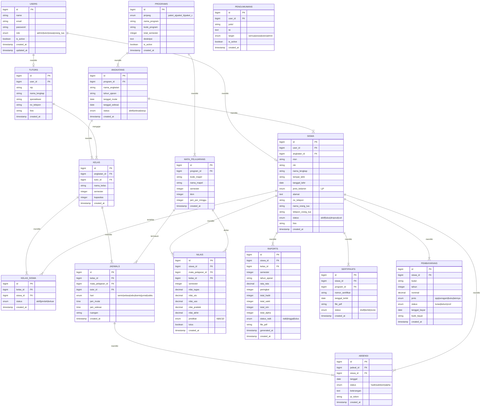

# 📊 ERD — Sistem Informasi PKBM
## Entity Relationship Diagram

## 📋 Tabel Summary

| Tabel | Deskripsi | Relasi Utama |
|-------|-----------|--------------|
| users | Semua pengguna sistem | - |
| programs | Program Paket A, B, C | - |
| angkatans | Tahun angkatan tiap program | program |
| siswa | Data lengkap siswa | user, angkatan |
| tutors | Data tutor/pengajar | user |
| mata_pelajarans | Daftar mata pelajaran per program | program |
| kelas | Kelas per angkatan | angkatan, tutor |
| kelas_siswa | Siswa yang terdaftar di kelas | kelas, siswa |
| jadwals | Jadwal pelajaran | kelas, mapel, tutor |
| absensi | Rekap kehadiran | jadwal, siswa |
| nilais | Nilai per mata pelajaran | siswa, mapel |
| raports | Raport per semester | siswa, kelas |
| sertifikats | Sertifikat kelulusan | siswa, program |
| pembayarans | Administrasi pembayaran | siswa |
| pengumumans | Pengumuman sistem | user |
